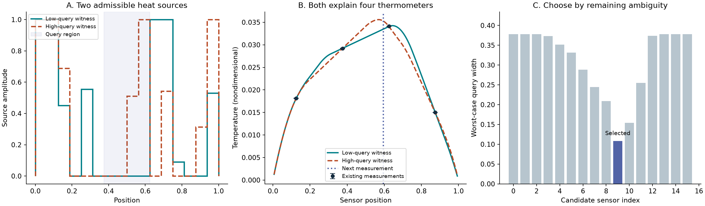
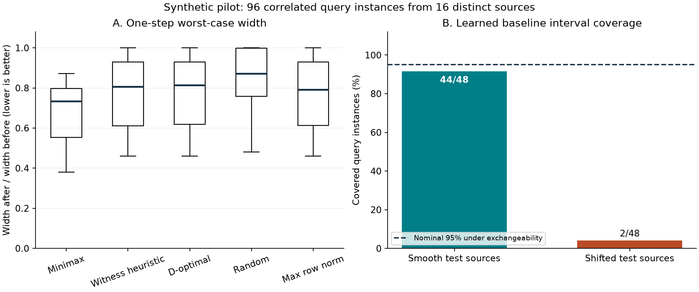

# Inverse Witness

**Check what the measurements leave ambiguous. Choose the next measurement with a verifiable bound.**

Inverse Witness is a small physics–math research toolkit for bounded linear inverse problems. It returns conflicting admissible source fields, a checked interval for the quantity you care about, and a minimax choice among candidate next measurements.



**Research status:** synthetic pilot and technical note, external scientific review pending. The theory builds on strict bounds, optimal recovery and worst-case sensor design. This release does not establish a new general theorem, a solution to a famous open conjecture, or state-of-the-art AI performance.

## Run the example

From a checkout, with Python 3.10 or later:

```bash
python -m pip install -e .
python -m inverse_witness.cli demo --output results/my-demo
python -m inverse_witness.cli verify results/my-demo/query-upper.json --max-gap 1/1000000
```

The demo solves a continuous steady heat-source inverse problem for a declared 16-cell source class. Four thermometer readings allow different sources. The next thermometer is selected before its reading is known. Files are written to a fresh directory; an existing result directory is never overwritten.

**Verify a published certificate without the optimizer or scientific packages:**

```bash
python -S -m inverse_witness.cli verify results/demo/query-upper.json --max-gap 1/1000000
python -S scripts/verify_results.py results/pilot
```

The checker uses exact rational arithmetic from the standard library. It checks feasibility and a dual-derived objective bound. The full replay also binds certificates to the declared physical instances and compares saved sensor scores.

## What is measured

Read the [actual pilot results](paper/RESULTS.md) and [methods and proofs](paper/METHODS.md). The benchmark includes continuous heat-source inversion, a grounded resistor network, three scalar queries, two bounded-noise levels, and a controlled source-distribution shift. Five sensor policies share the same data and candidate budget. A small random-feature learned baseline illustrates the difference between distribution-dependent intervals and physical admissibility.



All original synthetic data, exact certificate brackets, source vectors, configurations and evaluation rows are retained. Review the [data card](DATA_CARD.md) before extending the claims. The benchmark evaluates minimax on the criterion it explicitly optimizes; it is not evidence of superiority on every objective.

## Bring a linear physics operator

```python
from fractions import Fraction as F
from inverse_witness.solver import interval, choose_sensor

A, y, epsilon = [[F(1), F(1)]], [F(1)], F(1, 10)
c = [F(1), F(0)]  # Ask for the first bounded source.
answer = interval(A, y, epsilon, c)
decision = choose_sensor(A, y, epsilon, c,
                         [[F(1), F(0)], [F(1), F(1)]], F(1, 20))
print(answer["lower"], answer["upper"])
print(decision["selected"], decision["regret_upper"])
```

Here every source coordinate belongs to `[0,1]`. The first candidate resolves the requested coordinate more effectively than repeating the source sum. Inputs are exact integers, fractions or rational strings. To use another source box, explicitly transform its variables and offset the readings and query.

The public optimization API supports bounded linear operators, scalar linear queries and a finite list of single-row candidates. Degenerate instances may fail the numerical certificate search; a failure raises an error. The exact checker can still check a valid certificate obtained by another search procedure.

## Reproduce the research

```bash
python -m unittest discover -s tests -v
python -m inverse_witness.experiment --output results/new-pilot --seeds 4
python -S scripts/verify_results.py results/new-pilot
python -m pip install -e ".[figures]"
python scripts/make_figures.py --pilot results/new-pilot --demo results/my-demo
```

The declared pilot has 96 correlated query instances from 16 distinct test sources. Test sources are separate from training, tuning and calibration sources. See the run's configuration and environment record for exact versions and hashes. Running the full experiment regenerates the scientific result; checking a saved certificate is much cheaper.

## Research and participation

- [Opportunity analysis and adoption strategy](research/MARKET_RESEARCH.md)
- [Technical-note PDF](output/pdf/inverse-witness-technical-note.pdf)
- [Contribution guide](CONTRIBUTING.md): new operators, counterexamples, independent reproductions and learned sensor policies
- [Publication and ORCID route](PUBLICATION.md)

The useful next research target is a fast learned measurement policy with certified regret on held-out operators. It has not been trained here. New nonlinear or experimental data needs its own validity argument.

**Author:** Vinsy Moyya · [ORCID](https://orcid.org/0009-0003-0042-3556). Code and generated synthetic records: [MIT](LICENSE). Cite via [CITATION.cff](CITATION.cff), and separately credit the established methods in the technical note.
