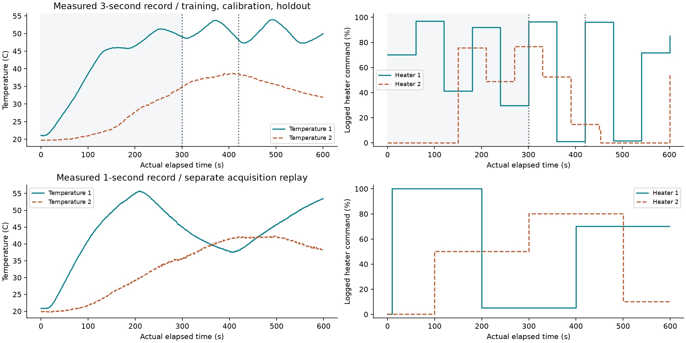
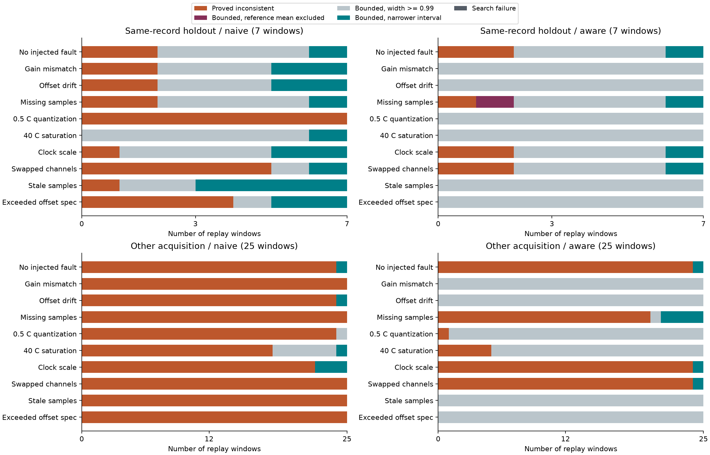

# Measured acquisitions and failure cases

Research date: 5 November 2026. **The empirical model does not transfer reliably to the second acquisition.** Correct sensor handling prevents specific acquisition mistakes, but can also produce intervals too wide to support a useful answer. This is a negative-results study, not real-world validation of accurate source reconstruction.

## Data actually used

We downloaded and pinned two upstream-reported hardware TCLab records from [APMonitor/arduino](https://github.com/APMonitor/arduino/tree/f36e65a70dd7122d1829883899e40e56bf6c4279), under Apache 2.0. There are 201 and 599 original rows (800 total), with two temperatures and two logged heater commands. The files retain original bytes, Git blob IDs and SHA-256 hashes; see [source notice](../data/tclab_apmonitor/NOTICE.md) and [provenance](../data/tclab_apmonitor/provenance.json). Acquisition documentation uses the hardware `TCLab()` class. We did not operate a device or independently establish the instrument's calibration or whether both records came from the same unit.



The original measured temperatures are used directly. Faults below are counterfactual modifications of those records, not claims that the upstream experiment had those labeled faults. Heater-command percentages are evaluation references; they are not independently measured heat flux or temperature-field ground truth.

For rational arithmetic, the parser rounds elapsed times and temperatures to 1e-6 seconds and C, and commands to 1e-6 percentage points (1e-8 of the full command range). Original CSV bytes remain unchanged. These are numerical representation choices, not claims of instrument precision.

## Frozen identification and evaluation contract

Fit a two-output empirical ARX model to temperature **rates**, using current temperature, previous measured rate, a constant, and both heater commands. Coefficients are fitted on transitions 1..99 of the 201-row record, then rounded to rational values. The residual-rate budget for each temperature is the **maximum absolute residual on transitions 100..139**, not a proved hardware noise bound. Frozen budgets are 0.102839 and 0.119767 C/s. The training design condition number is 509.5.

Evaluate seven nonoverlapping 8-transition windows beginning at indices 140,148,...,188 of that record, plus 25 windows beginning at 1,25,...,577 of the separate 599-row acquisition. No held-out command labels fit the coefficients or budgets. Adjacent splits share boundary temperature states, and windows/fault replays are correlated. The data comprise two acquisition files, not a population of independently calibrated instruments.

For each window, the unknowns are 16 command fractions in [0,1], two heaters per transition. The query is the mean heater-1 command. Logged elapsed time is used without resampling. Recorded temperatures form the measured right-hand side; heater commands enter that reconstruction only as hidden evaluation references. The empirical model and every case are retained in `results/acquisition`.

## Acquisition handling

The adapter supports stable row IDs, individual noise budgets, positive gain intervals, offset intervals, elementwise operator-error bounds, missing rows, and one-sided saturation. It never replaces a missing measurement with zero. Independent calibration intervals relax correlations between repeated temperatures and can be conservative.

For each window we compare naive handling with metadata-aware handling under ten declared conditions:

| Replay | Injected change | Aware handling |
|---|---|---|
| nominal | No injected fault; actual irregular sampling remains | Use logged times and channels |
| gain | T1 gain 1.03; T2 gain 0.97 | Declared gain ranges [1.02,1.04], [0.96,0.98] |
| offset_drift | Linear drift up to +0.8/-0.6 C | +/-1 C offset intervals |
| dropout | Four T1 samples per 24-sample burst | Missing/censored intervals; no zero fill |
| quantization | Nearest 0.5 C | +/-0.25 C quantization cells |
| saturation | Upper rail 40 C | One-sided temperature bounds |
| clock_scale | Recorded clock stretched by 10% | Known clock-scale correction |
| channel_swap | Temperature array order swapped | Stable channel labels restore order |
| stale_sample | T1 repeats a two-sample-old reading | Age flag marks T1 unavailable |
| out_of_budget | +/-3 C offsets | Only +/-0.2 C declared: specification intentionally false |

The “aware” arm receives declared calibration/quality metadata, not a learned fault diagnosis. It does not know source commands. Offline `input_assumptions_hold` audits use the unmodified record to check the injected sensor assumptions; they would not be available for an unknown live fault. `baseline_model_budget_holds` separately checks the original empirical model envelope before faults are added. Neither audit should be confused with an online detector.

## Measured outcomes

The completed run has **640 replay cases and 912 exact certificates**, with 0 unclassified numerical search failures. An inconsistency is reported only with an exactly checked boxed Farkas contradiction. A bounded case retains both endpoint certificates, even when it excludes the reference mean. A width >=0.99 is explicitly reported as practically uninformative relative to the unit prior range.



Without injected faults, the same-record holdout has **2/7 inconsistent windows**. Of 5 bounded windows, 4 have width >=0.99. On the separate acquisition, **24/25 windows are inconsistent**, and the full logged command vector is admissible in only 0/25. A query mean can fall inside a wide interval even when the full reference vector violates the model; query coverage alone does not validate the physics.

Across counterfactual replays, naive handling has 0 bounded intervals excluding the reference mean, and aware handling has 1. These are descriptive counts for matched, correlated cases, not general failure probabilities. Aware handling need not reduce every failure count: dropping contradictory information can reveal a feasible but wrong model that was previously rejected. Wider intervals can hide a misspecified sensor budget. In particular, the deliberately exceeded offset specification must not be called valid merely because its interval is nonempty.

One concrete case is `second_order_data-0148-dropout-aware`: the checked interval is [0.000000, 0.947266], while the logged reference mean is 0.961305. The missing-data assumptions hold against the original digital record, but the baseline model residual budget fails. Removing unavailable rows restores feasibility without fixing model mismatch, and the reference mean is still excluded. This is a retained failure, not a successful reconstruction.

| Record | Variation | Handling | Cases | Proved inconsistent | Bounded mean excluded | Width >=0.99 | Input assumptions hold |
|---|---|---|---:|---:|---:|---:|---:|
| Same-record holdout | nominal | naive | 7 | 2 | 0 | 4 | 7 |
| Same-record holdout | nominal | aware | 7 | 2 | 0 | 4 | 7 |
| Same-record holdout | gain | naive | 7 | 2 | 0 | 3 | 0 |
| Same-record holdout | gain | aware | 7 | 0 | 0 | 7 | 7 |
| Same-record holdout | offset_drift | naive | 7 | 2 | 0 | 3 | 0 |
| Same-record holdout | offset_drift | aware | 7 | 0 | 0 | 7 | 7 |
| Same-record holdout | dropout | naive | 7 | 2 | 0 | 4 | 5 |
| Same-record holdout | dropout | aware | 7 | 1 | 1 | 4 | 7 |
| Same-record holdout | quantization | naive | 7 | 7 | 0 | 0 | 0 |
| Same-record holdout | quantization | aware | 7 | 0 | 0 | 7 | 7 |
| Same-record holdout | saturation | naive | 7 | 0 | 0 | 6 | 0 |
| Same-record holdout | saturation | aware | 7 | 0 | 0 | 7 | 7 |
| Same-record holdout | clock_scale | naive | 7 | 1 | 0 | 4 | 0 |
| Same-record holdout | clock_scale | aware | 7 | 2 | 0 | 4 | 7 |
| Same-record holdout | channel_swap | naive | 7 | 5 | 0 | 1 | 0 |
| Same-record holdout | channel_swap | aware | 7 | 2 | 0 | 4 | 7 |
| Same-record holdout | stale_sample | naive | 7 | 1 | 0 | 2 | 0 |
| Same-record holdout | stale_sample | aware | 7 | 0 | 0 | 7 | 7 |
| Same-record holdout | out_of_budget | naive | 7 | 4 | 0 | 1 | 0 |
| Same-record holdout | out_of_budget | aware | 7 | 0 | 0 | 7 | 0 |
| Other acquisition | nominal | naive | 25 | 24 | 0 | 0 | 25 |
| Other acquisition | nominal | aware | 25 | 24 | 0 | 0 | 25 |
| Other acquisition | gain | naive | 25 | 25 | 0 | 0 | 0 |
| Other acquisition | gain | aware | 25 | 0 | 0 | 25 | 25 |
| Other acquisition | offset_drift | naive | 25 | 24 | 0 | 0 | 0 |
| Other acquisition | offset_drift | aware | 25 | 0 | 0 | 25 | 25 |
| Other acquisition | dropout | naive | 25 | 25 | 0 | 0 | 0 |
| Other acquisition | dropout | aware | 25 | 20 | 0 | 1 | 25 |
| Other acquisition | quantization | naive | 25 | 24 | 0 | 1 | 0 |
| Other acquisition | quantization | aware | 25 | 1 | 0 | 24 | 25 |
| Other acquisition | saturation | naive | 25 | 18 | 0 | 6 | 4 |
| Other acquisition | saturation | aware | 25 | 5 | 0 | 20 | 25 |
| Other acquisition | clock_scale | naive | 25 | 22 | 0 | 0 | 0 |
| Other acquisition | clock_scale | aware | 25 | 24 | 0 | 0 | 25 |
| Other acquisition | channel_swap | naive | 25 | 25 | 0 | 0 | 0 |
| Other acquisition | channel_swap | aware | 25 | 24 | 0 | 0 | 25 |
| Other acquisition | stale_sample | naive | 25 | 25 | 0 | 0 | 0 |
| Other acquisition | stale_sample | aware | 25 | 0 | 0 | 25 | 25 |
| Other acquisition | out_of_budget | naive | 25 | 25 | 0 | 0 | 0 |
| Other acquisition | out_of_budget | aware | 25 | 0 | 0 | 25 | 0 |

## What is fixed and what remains open

The implementation now preserves channel identity, propagates known calibration/censoring information, rejects malformed acquisitions, distinguishes exact inconsistency from solver failure, and retains silent exclusions instead of hiding them. Exact checking verifies statements about the **encoded** inverse problem. It does not establish that the ARX model, instrument calibration, or empirical residual envelope is correct.

Transfer changes sampling cadence, operating temperatures and input schedules together; this study cannot attribute failure to a single cause. The model uses lagged rates without a continuous latent heater-state model. No actual acquisition of a new minimax-selected thermometer was performed. Better transfer needs a cadence-consistent dynamical model, additional independent hardware runs, explicit latent/state uncertainty, and justified instrument/model discrepancy bounds. Budgets must be chosen without using the target test labels.

## Reproduce and inspect

```bash
python -m inverse_witness.cli acquisition --output results/new-acquisition --data data/tclab_apmonitor
python -S scripts/verify_acquisition.py results/new-acquisition
python -m unittest discover -s tests -v
```

The standard-library verifier checks pinned raw-data hashes, frozen model and acquisition binding, rational endpoint/inconsistency proofs, source-reference audits, case completeness, CSV metrics and group summaries. It shares the declared forward-model construction with the producer; it is an independent arithmetic replay, not external validation of the model or source provenance. The completed local run took 58.4 seconds; this is not a controlled performance comparison. Code is MIT; imported and derived measured-data records retain Apache-2.0 attribution.
