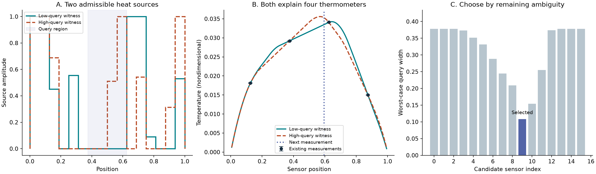
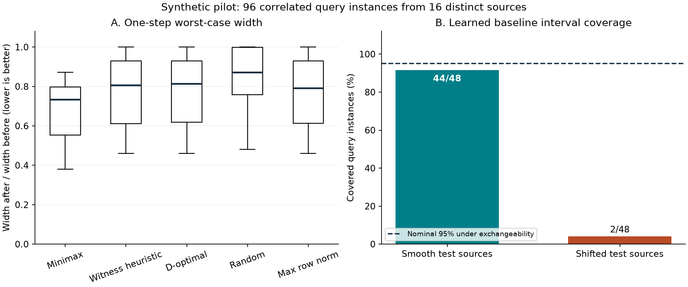

# Measured synthetic pilot

This report is generated from `results/pilot/metrics.csv` and `summary.json`. The run contains **96 query instances**, five sensing policies and **2146 exact rational certificate brackets**. The query instances reuse 16 distinct sources; they are not independent replicates.

The example starts with width 0.377848 for the local source mean. It selects s=19/32. Its worst-case next width is 0.108417; the realized zero-noise next reading gives width 0.076623. The realized and worst-case values answer different questions.

| Policy | Median worst-case width ratio | Instances worse than minimax by more than 1e-6 |
|---|---:|---:|
| Minimax | 0.7344 | 0/96 |
| Witness heuristic | 0.8061 | 58/96 |
| D-optimal | 0.8133 | 78/96 |
| Random | 0.8724 | 78/96 |
| Max row norm | 0.7920 | 64/96 |

These policies are compared on the exact objective that minimax explicitly optimizes. Its advantage on that objective is expected by construction. This experiment does not establish an across-the-board advantage in realized width, average error, runtime or other sensing objectives. Ties and small differences are retained; no significance test treats the correlated rows as independent.

The largest exact candidate-selection regret bound was 3.6e-12. Every certificate's optimization gap was at most 4.39e-12. All 96/96 initial query intervals contained their simulated truth, as they must when all declared assumptions hold. This is an implementation check, not an empirical estimate of a universal coverage probability.

The random-feature learned baseline with nominal 95% split-conformal intervals covered 44/48 smooth and 2/48 shifted query instances. The shifted source law violates exchangeability with calibration. These counts show this baseline's behavior in this small controlled test; they do not characterize frontier AI models or disprove conformal coverage under its assumptions.

The benchmark took 195.4 seconds on the recorded local environment, including certificate checking and output. It is not a controlled speed comparison. Runtime versions: Python 3.12.14, NumPy 2.5.4, SciPy 1.18.1. Exact configuration and source hashes accompany the run.

Reproduce with `python -m inverse_witness.experiment --output results/new-pilot --seeds 4`. Recheck saved mathematical and physical instances using `python -S scripts/verify_results.py results/pilot`. See [methods](METHODS.md), [data assumptions](../DATA_CARD.md) and [market analysis](../research/MARKET_RESEARCH.md).
